# Casos de uso — portal-emetra

Código de referencia: `85ab07b216ef7cccafd28a47aba068520efec8be`; línea de integración revisada: `estado-recuperado`. Describe capacidades presentes en esa revisión; la configuración y las autorizaciones efectivas de un servidor se comprueban por separado. Esta edición se preparó sin conectarse a Oracle, SMTP ni servidores institucionales.

La ampliación EVIAL de esta edición se documenta al final con su referencia de código propia.

Los enlaces de código fijan esa revisión para que sigan siendo consultables cuando `main` excluya herramientas de desarrollo. Al modificar un comportamiento se deben actualizar su caso de uso, configuración y referencia de código.

Guía de arquitectura, configuración y cambios: [manual-técnico.md](manual-t%C3%A9cnico.md).

## Índice

- [CU-01 · Consultar noticias y preguntas frecuentes](#cu-01)
- [CU-02 · Consultar Predice, detalle y registrar evento](#cu-02)
- [CU-03 · Consultar rutas y desplazamiento](#cu-03)
- [CU-04 · Consultar solvencia y generar o descargar documentos](#cu-04)
- [CU-05 · Consultar notificación SAT y PDF](#cu-05)
- [CU-06 · Tramitar expediente de tránsito y envío de resolución](#cu-06)
- [CU-07 · Suscribirse o cancelar avisos y enviar contacto](#cu-07)
- [CU-08 · Autenticar sesión de servicios y diagnosticar backend](#cu-08)
- [CU-09 · Abrir enlace VIVI y consultar resumen del caso](#cu-09)
- [CU-10 · Aceptar caso VIVI y conservar resultado al reabrir](#cu-10)
- [CU-11 · Consultar formulario y documentos de defensa VIVI; compatibilidad heredada](#cu-11)

- [CU-12 · Explorar capacitaciones EVIAL](#cu-12)
- [CU-13 · Inscribirse y recuperar acceso al curso](#cu-13)
- [CU-14 · Estudiar materiales y completar examen](#cu-14)
- [CU-15 · Abrir comprobante y solicitar correo](#cu-15)
- [CU-16 · Compartir formación y evaluar por enlace individual](#cu-16)
- [CU-17 · Consultar participantes, QR y asistencia del personal](#cu-17)
- [CU-18 · Editar capacitación y materiales](#cu-18)

- [Índice de operaciones y rutas](#operaciones)
- [Criterios de cobertura](#cobertura)

Los casos agrupan variantes de una misma finalidad (por ejemplo consultar, crear y modificar un catálogo). Las rutas y operaciones del anexo permiten encontrar el caso sin recorrer todo el código. Los diagramas describen decisiones principales; las excepciones de cada caso completan los caminos alternativos.

## CU-01 · Consultar noticias y preguntas frecuentes

**Actor:** Visitante o usuario autorizado del servicio.

**Precondiciones y entrada:** Datos de entrada válidos y backend configurado.

**Flujo y resultado**

1. Abrir inicio, listado o noticia.
2. Consultar el BFF público.
3. Mostrar contenido, categorías y medios publicados.
4. Navegar al detalle o pregunta relacionada.

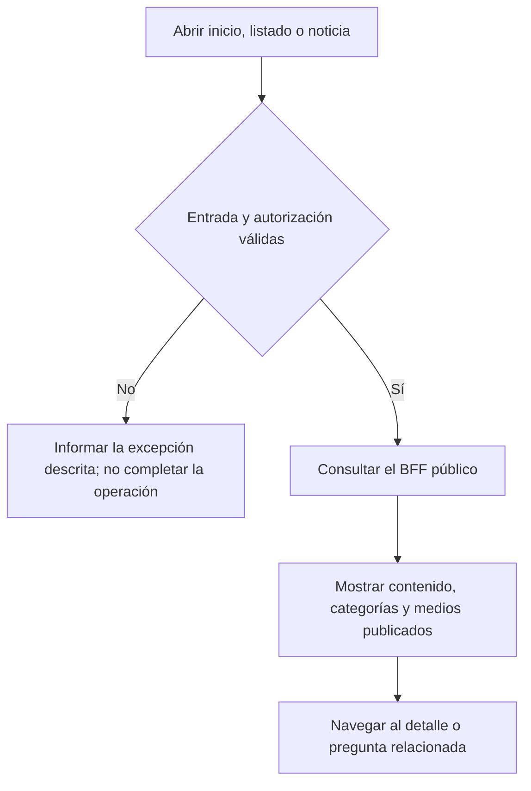

**Excepciones y alternativas**

- Slug inexistente se muestra como contenido no encontrado.
- Fallo de imagen no debe romper el artículo.
- No exponer noticias privadas por reutilizar endpoint administrativo.

**Objetos y persistencia**

Indirecto: CMS_SCHEMA.TB_NOTICIA y relaciones; FAQ_SCHEMA.TB_FAQ en api-portal.

**Archivos involucrados**

- [src/app/api/faq/route.ts](https://github.com/EMETRA/portal-emetra/blob/85ab07b216ef7cccafd28a47aba068520efec8be/src/app/api/faq/route.ts)
- [src/app/api/public-news/[slug]/route.ts](https://github.com/EMETRA/portal-emetra/blob/85ab07b216ef7cccafd28a47aba068520efec8be/src/app/api/public-news/%5Bslug%5D/route.ts)
- [src/app/api/public-news/route.ts](https://github.com/EMETRA/portal-emetra/blob/85ab07b216ef7cccafd28a47aba068520efec8be/src/app/api/public-news/route.ts)
- [src/app/api/public-news/uploads/[...path]/route.ts](https://github.com/EMETRA/portal-emetra/blob/85ab07b216ef7cccafd28a47aba068520efec8be/src/app/api/public-news/uploads/%5B...path%5D/route.ts)
- [src/app/noticias/[slug]/page.tsx](https://github.com/EMETRA/portal-emetra/blob/85ab07b216ef7cccafd28a47aba068520efec8be/src/app/noticias/%5Bslug%5D/page.tsx)
- [src/app/page.tsx](https://github.com/EMETRA/portal-emetra/blob/85ab07b216ef7cccafd28a47aba068520efec8be/src/app/page.tsx)
- [src/components/server/organisms/NewsArticle/NewsArticle.module.scss](https://github.com/EMETRA/portal-emetra/blob/85ab07b216ef7cccafd28a47aba068520efec8be/src/components/server/organisms/NewsArticle/NewsArticle.module.scss)
- [src/components/server/organisms/NewsArticle/NewsArticle.tsx](https://github.com/EMETRA/portal-emetra/blob/85ab07b216ef7cccafd28a47aba068520efec8be/src/components/server/organisms/NewsArticle/NewsArticle.tsx)
- [src/components/server/organisms/NewsArticle/index.tsx](https://github.com/EMETRA/portal-emetra/blob/85ab07b216ef7cccafd28a47aba068520efec8be/src/components/server/organisms/NewsArticle/index.tsx)
- [src/components/server/organisms/NewsArticle/types.tsx](https://github.com/EMETRA/portal-emetra/blob/85ab07b216ef7cccafd28a47aba068520efec8be/src/components/server/organisms/NewsArticle/types.tsx)
- [src/components/server/organisms/NewsGallery/NewsGallery.module.scss](https://github.com/EMETRA/portal-emetra/blob/85ab07b216ef7cccafd28a47aba068520efec8be/src/components/server/organisms/NewsGallery/NewsGallery.module.scss)
- [src/components/server/organisms/NewsGallery/NewsGallery.tsx](https://github.com/EMETRA/portal-emetra/blob/85ab07b216ef7cccafd28a47aba068520efec8be/src/components/server/organisms/NewsGallery/NewsGallery.tsx)
- [src/components/server/organisms/NewsGallery/index.tsx](https://github.com/EMETRA/portal-emetra/blob/85ab07b216ef7cccafd28a47aba068520efec8be/src/components/server/organisms/NewsGallery/index.tsx)
- [src/components/server/organisms/NewsGallery/types.tsx](https://github.com/EMETRA/portal-emetra/blob/85ab07b216ef7cccafd28a47aba068520efec8be/src/components/server/organisms/NewsGallery/types.tsx)
- [src/components/server/organisms/NewsList/NewsList.module.scss](https://github.com/EMETRA/portal-emetra/blob/85ab07b216ef7cccafd28a47aba068520efec8be/src/components/server/organisms/NewsList/NewsList.module.scss)
- [src/components/server/organisms/NewsList/NewsList.tsx](https://github.com/EMETRA/portal-emetra/blob/85ab07b216ef7cccafd28a47aba068520efec8be/src/components/server/organisms/NewsList/NewsList.tsx)
- [src/components/server/organisms/NewsList/index.tsx](https://github.com/EMETRA/portal-emetra/blob/85ab07b216ef7cccafd28a47aba068520efec8be/src/components/server/organisms/NewsList/index.tsx)
- [src/components/server/organisms/NewsList/types.tsx](https://github.com/EMETRA/portal-emetra/blob/85ab07b216ef7cccafd28a47aba068520efec8be/src/components/server/organisms/NewsList/types.tsx)

## CU-02 · Consultar Predice, detalle y registrar evento

**Actor:** Visitante o usuario autorizado del servicio.

**Precondiciones y entrada:** Datos de entrada válidos y backend configurado.

**Flujo y resultado**

1. Abrir calendario o mapa de eventos.
2. Elegir filtros o detalle.
3. Consultar eventos visibles.
4. Completar y validar datos si el servicio permite registrar.
5. Enviar y mostrar respuesta del backend.

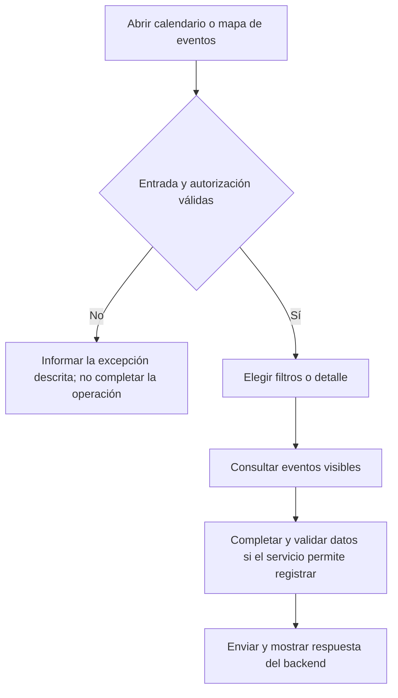

**Excepciones y alternativas**

- Evento fuera de visibilidad no se inventa como público.
- Error de consulta conserva un estado de reintento.
- El frontend no concede permisos de edición por mostrar un formulario.

**Objetos y persistencia**

Indirecto: PREDICE_SCHEMA.TB_EVENTOS_CALENDARIO y catálogos, mediante api-portal.

**Archivos involucrados**

- [src/app/api/predice/eventos/[id]/route.ts](https://github.com/EMETRA/portal-emetra/blob/85ab07b216ef7cccafd28a47aba068520efec8be/src/app/api/predice/eventos/%5Bid%5D/route.ts)
- [src/app/api/predice/eventos/route.ts](https://github.com/EMETRA/portal-emetra/blob/85ab07b216ef7cccafd28a47aba068520efec8be/src/app/api/predice/eventos/route.ts)
- [src/app/predice/[id]/page.tsx](https://github.com/EMETRA/portal-emetra/blob/85ab07b216ef7cccafd28a47aba068520efec8be/src/app/predice/%5Bid%5D/page.tsx)
- [src/app/predice/nuevo/page.tsx](https://github.com/EMETRA/portal-emetra/blob/85ab07b216ef7cccafd28a47aba068520efec8be/src/app/predice/nuevo/page.tsx)
- [src/app/predice/page.tsx](https://github.com/EMETRA/portal-emetra/blob/85ab07b216ef7cccafd28a47aba068520efec8be/src/app/predice/page.tsx)

## CU-03 · Consultar rutas y desplazamiento

**Actor:** Visitante o usuario autorizado del servicio.

**Precondiciones y entrada:** Datos de entrada válidos y backend configurado.

**Flujo y resultado**

1. Abrir el mapa de desplazamiento.
2. Consultar rutas y puntos al BFF.
3. Representar recorrido con atribución.
4. Elegir ruta y consultar detalle.

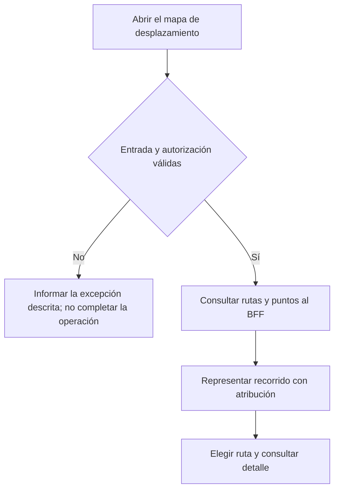

**Excepciones y alternativas**

- Ruta sin datos no se dibuja con coordenadas inventadas.
- Falta de mapa remoto no altera la ruta persistida.
- Mantener atribución al proveedor cartográfico.

**Objetos y persistencia**

Indirecto: ROUTES_SCHEMA.TB_RUTA_RT, TB_TRACK_RT y TB_PASO_PUNTO_RT en api-portal.

**Archivos involucrados**

- [src/app/api/routes/[id]/route.ts](https://github.com/EMETRA/portal-emetra/blob/85ab07b216ef7cccafd28a47aba068520efec8be/src/app/api/routes/%5Bid%5D/route.ts)
- [src/app/api/routes/route.ts](https://github.com/EMETRA/portal-emetra/blob/85ab07b216ef7cccafd28a47aba068520efec8be/src/app/api/routes/route.ts)
- [src/app/desplazamiento/page.tsx](https://github.com/EMETRA/portal-emetra/blob/85ab07b216ef7cccafd28a47aba068520efec8be/src/app/desplazamiento/page.tsx)
- [src/data/remote/route/useRoute.ts](https://github.com/EMETRA/portal-emetra/blob/85ab07b216ef7cccafd28a47aba068520efec8be/src/data/remote/route/useRoute.ts)
- [src/data/remote/route/useRoutes.ts](https://github.com/EMETRA/portal-emetra/blob/85ab07b216ef7cccafd28a47aba068520efec8be/src/data/remote/route/useRoutes.ts)

## CU-04 · Consultar solvencia y generar o descargar documentos

**Actor:** Visitante o usuario autorizado del servicio.

**Precondiciones y entrada:** Datos de entrada válidos y backend configurado.

**Flujo y resultado**

1. Completar datos del servicio de solvencia.
2. Consultar y validar situación en el backend.
3. Revisar datos de documento o recibo.
4. Solicitar la operación de emisión prevista.
5. Mostrar o descargar PDF.

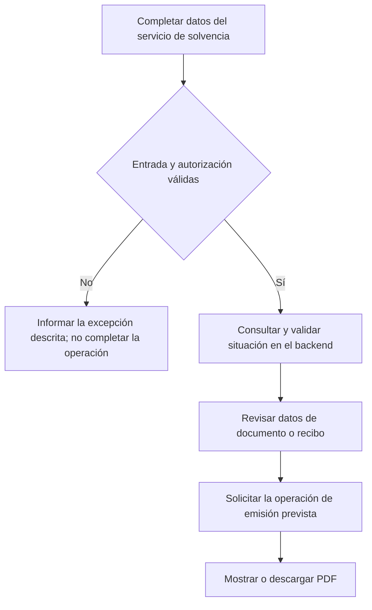

**Excepciones y alternativas**

- Resultado de deuda no equivale a fallo del servicio.
- No repetir emisión para resolver un error de visualización.
- Documento no disponible requiere consultar resultado anterior.

**Objetos y persistencia**

Indirecto: fuentes de SolvenciaService, ReciboService y tránsito de api-portal; el frontend no escribe Oracle.

**Archivos involucrados**

- [src/app/(services)/solvencia/page.tsx](https://github.com/EMETRA/portal-emetra/blob/85ab07b216ef7cccafd28a47aba068520efec8be/src/app/%28services%29/solvencia/page.tsx)
- [src/app/api/solvencia/get-data/route.ts](https://github.com/EMETRA/portal-emetra/blob/85ab07b216ef7cccafd28a47aba068520efec8be/src/app/api/solvencia/get-data/route.ts)
- [src/app/api/solvencia/pdf/route.ts](https://github.com/EMETRA/portal-emetra/blob/85ab07b216ef7cccafd28a47aba068520efec8be/src/app/api/solvencia/pdf/route.ts)
- [src/app/api/solvencia/recibo-pdf/route.ts](https://github.com/EMETRA/portal-emetra/blob/85ab07b216ef7cccafd28a47aba068520efec8be/src/app/api/solvencia/recibo-pdf/route.ts)
- [src/app/api/solvencia/recibo/route.ts](https://github.com/EMETRA/portal-emetra/blob/85ab07b216ef7cccafd28a47aba068520efec8be/src/app/api/solvencia/recibo/route.ts)
- [src/app/api/solvencia/validar/route.ts](https://github.com/EMETRA/portal-emetra/blob/85ab07b216ef7cccafd28a47aba068520efec8be/src/app/api/solvencia/validar/route.ts)

## CU-05 · Consultar notificación SAT y PDF

**Actor:** Visitante o usuario autorizado del servicio.

**Precondiciones y entrada:** Datos de entrada válidos y backend configurado.

**Flujo y resultado**

1. Ingresar datos de consulta.
2. Enviar al BFF SAT.
3. Mostrar respuesta de notificación.
4. Solicitar documento correspondiente.
5. Visualizar o descargar PDF.

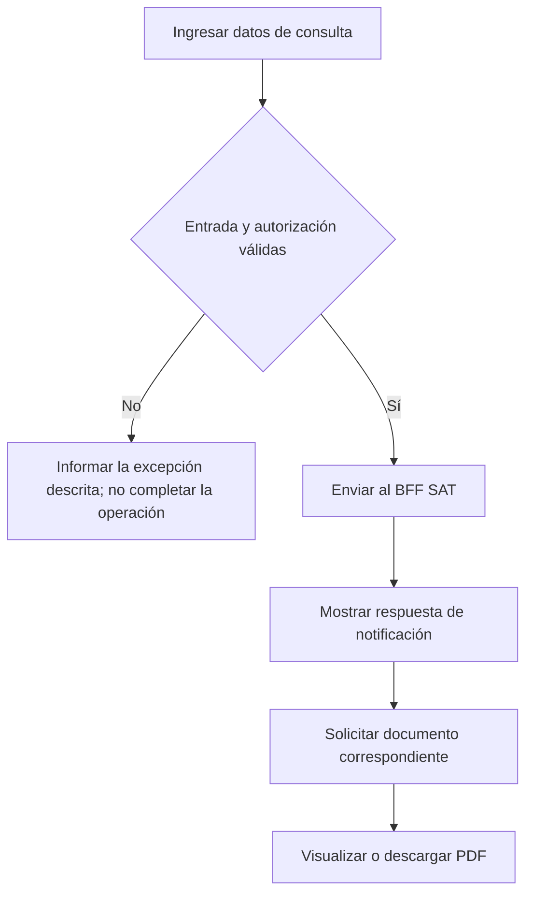

**Excepciones y alternativas**

- Error remoto de SAT no equivale a placa sin datos.
- PDF ausente no autoriza generar otra notificación sin revisar estado.
- No registrar datos personales en el navegador.

**Objetos y persistencia**

Indirecto: módulo notificado y tránsito de api-portal; generación PDF según ese servicio.

**Archivos involucrados**

- [src/app/(services)/notificaciones/page.tsx](https://github.com/EMETRA/portal-emetra/blob/85ab07b216ef7cccafd28a47aba068520efec8be/src/app/%28services%29/notificaciones/page.tsx)
- [src/app/api/sat/consulta/route.ts](https://github.com/EMETRA/portal-emetra/blob/85ab07b216ef7cccafd28a47aba068520efec8be/src/app/api/sat/consulta/route.ts)
- [src/app/api/sat/getpdf/route.ts](https://github.com/EMETRA/portal-emetra/blob/85ab07b216ef7cccafd28a47aba068520efec8be/src/app/api/sat/getpdf/route.ts)
- [src/app/api/sat/pdf/route.ts](https://github.com/EMETRA/portal-emetra/blob/85ab07b216ef7cccafd28a47aba068520efec8be/src/app/api/sat/pdf/route.ts)
- [src/app/notificaciones-sat/page.tsx](https://github.com/EMETRA/portal-emetra/blob/85ab07b216ef7cccafd28a47aba068520efec8be/src/app/notificaciones-sat/page.tsx)

## CU-06 · Tramitar expediente de tránsito y envío de resolución

**Actor:** Visitante o usuario autorizado del servicio.

**Precondiciones y entrada:** Datos de entrada válidos y backend configurado.

**Flujo y resultado**

1. Consultar remisiones o expediente.
2. Completar datos y juzgado según contrato.
3. Validar y registrar por el BFF.
4. Mostrar resultado y documento o paso siguiente.

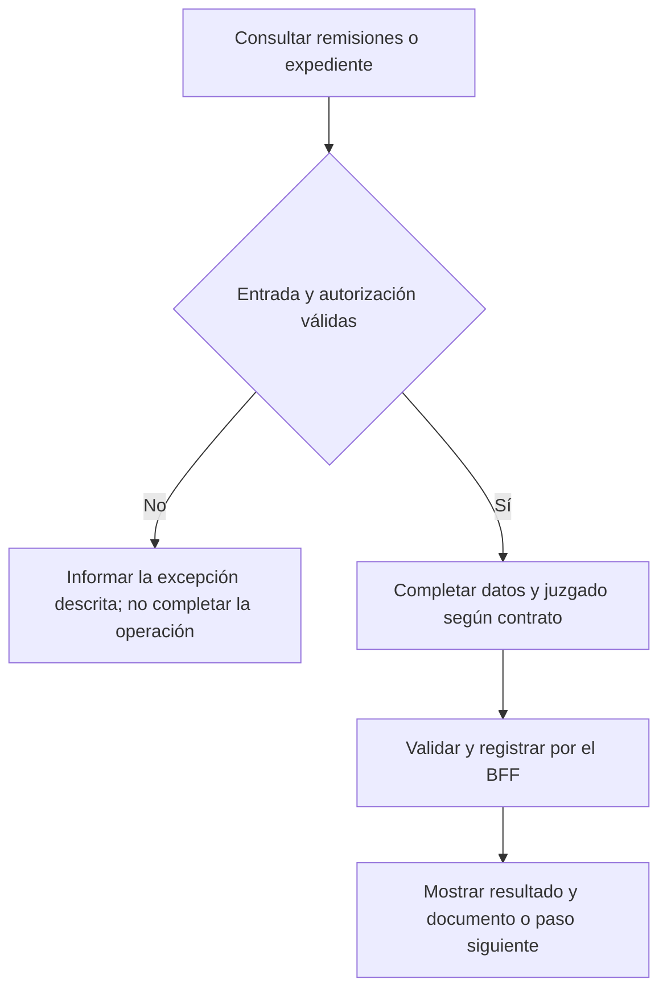

**Excepciones y alternativas**

- Datos o juzgado no válidos se rechazan.
- Expediente inexistente se diferencia de caída del API.
- No confundir este trámite con resolución judicial VIVI del Panel.

**Objetos y persistencia**

Indirecto: TB_EXPEDIENTES_TRANSITO y TB_MULTAS_EXPEDIENTE_TRANSITO de api-portal, con fuentes de remisiones BASEDATOS.

**Archivos involucrados**

- [src/app/(services)/enviar-resolucion/[juzgado]/page.tsx](https://github.com/EMETRA/portal-emetra/blob/85ab07b216ef7cccafd28a47aba068520efec8be/src/app/%28services%29/enviar-resolucion/%5Bjuzgado%5D/page.tsx)
- [src/app/(services)/juzgado/page.tsx](https://github.com/EMETRA/portal-emetra/blob/85ab07b216ef7cccafd28a47aba068520efec8be/src/app/%28services%29/juzgado/page.tsx)
- [src/app/api/juzgado/consultar/route.ts](https://github.com/EMETRA/portal-emetra/blob/85ab07b216ef7cccafd28a47aba068520efec8be/src/app/api/juzgado/consultar/route.ts)
- [src/app/api/juzgado/registrar/route.ts](https://github.com/EMETRA/portal-emetra/blob/85ab07b216ef7cccafd28a47aba068520efec8be/src/app/api/juzgado/registrar/route.ts)
- [src/app/api/juzgado/remisiones/route.ts](https://github.com/EMETRA/portal-emetra/blob/85ab07b216ef7cccafd28a47aba068520efec8be/src/app/api/juzgado/remisiones/route.ts)

## CU-07 · Suscribirse o cancelar avisos y enviar contacto

**Actor:** Visitante o usuario autorizado del servicio.

**Precondiciones y entrada:** Datos de entrada válidos y backend configurado.

**Flujo y resultado**

1. Abrir formulario institucional.
2. Validar datos y acción solicitada.
3. Enviar suscripción, baja o contacto por su BFF.
4. Mostrar instrucciones o resultado de la operación.

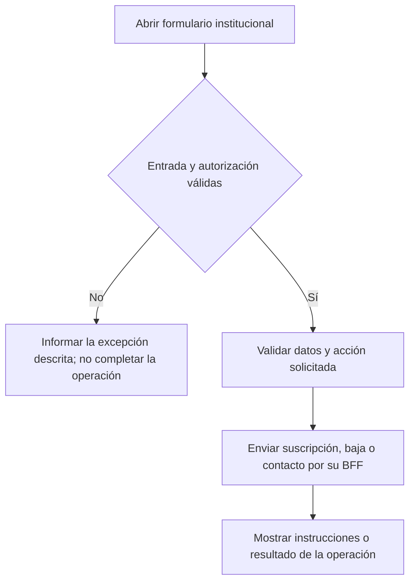

**Excepciones y alternativas**

- Correo de contacto enviado no modifica una suscripción.
- Token no válido no confirma baja.
- Fallo de transporte conserva formulario y mensaje de reintento.

**Objetos y persistencia**

Indirecto: ADMEMETRA.TB_CLIENTE_SUS, TB_SUSCRIPCION_CLIENTE_SUS y relaciones para suscripciones; contacto según su adaptador.

**Archivos involucrados**

- [src/app/api/contact/route.ts](https://github.com/EMETRA/portal-emetra/blob/85ab07b216ef7cccafd28a47aba068520efec8be/src/app/api/contact/route.ts)
- [src/app/api/notificaciones/desuscripcion/route.ts](https://github.com/EMETRA/portal-emetra/blob/85ab07b216ef7cccafd28a47aba068520efec8be/src/app/api/notificaciones/desuscripcion/route.ts)
- [src/app/api/notificaciones/suscripcion/route.ts](https://github.com/EMETRA/portal-emetra/blob/85ab07b216ef7cccafd28a47aba068520efec8be/src/app/api/notificaciones/suscripcion/route.ts)
- [src/app/sumate/page.tsx](https://github.com/EMETRA/portal-emetra/blob/85ab07b216ef7cccafd28a47aba068520efec8be/src/app/sumate/page.tsx)

## CU-08 · Autenticar sesión de servicios y diagnosticar backend

**Actor:** Visitante o usuario autorizado del servicio.

**Precondiciones y entrada:** Datos de entrada válidos y backend configurado.

**Flujo y resultado**

1. Solicitar acceso o diagnóstico técnico.
2. Resolver configuración de upstream.
3. Enviar petición al backend previsto.
4. Mostrar respuesta sin exponer credenciales al cliente.

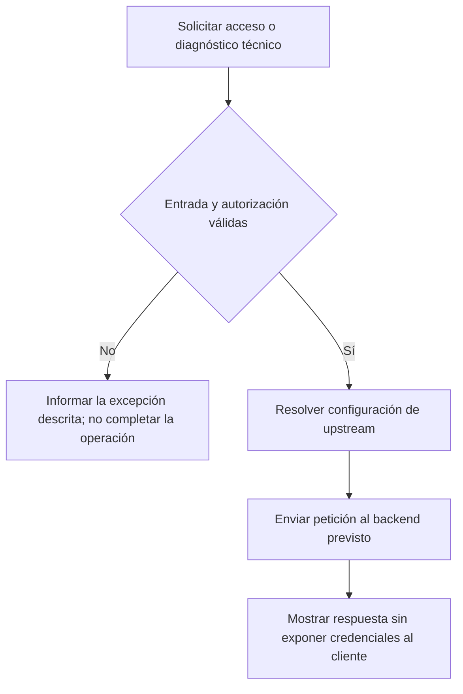

**Excepciones y alternativas**

- El diagnóstico puede revelar contexto de upstream y debe limitarse operativamente.
- Salud backend no certifica trámites de todos los módulos.
- Login del portal no es la sesión móvil VIVI.

**Objetos y persistencia**

Sesión y backend api-portal; health no modifica registros de negocio. No hay Oracle directo.

**Archivos involucrados**

- [src/app/api/auth/session/route.ts](https://github.com/EMETRA/portal-emetra/blob/85ab07b216ef7cccafd28a47aba068520efec8be/src/app/api/auth/session/route.ts)
- [src/app/api/health/backend/route.ts](https://github.com/EMETRA/portal-emetra/blob/85ab07b216ef7cccafd28a47aba068520efec8be/src/app/api/health/backend/route.ts)
- [src/app/auth/page.tsx](https://github.com/EMETRA/portal-emetra/blob/85ab07b216ef7cccafd28a47aba068520efec8be/src/app/auth/page.tsx)
- [src/lib/backend/client.ts](https://github.com/EMETRA/portal-emetra/blob/85ab07b216ef7cccafd28a47aba068520efec8be/src/lib/backend/client.ts)
- [src/lib/backend/fetch-upstream.ts](https://github.com/EMETRA/portal-emetra/blob/85ab07b216ef7cccafd28a47aba068520efec8be/src/lib/backend/fetch-upstream.ts)
- [src/lib/backend/handler.ts](https://github.com/EMETRA/portal-emetra/blob/85ab07b216ef7cccafd28a47aba068520efec8be/src/lib/backend/handler.ts)
- [src/lib/backend/proxy.ts](https://github.com/EMETRA/portal-emetra/blob/85ab07b216ef7cccafd28a47aba068520efec8be/src/lib/backend/proxy.ts)

## CU-09 · Abrir enlace VIVI y consultar resumen del caso

**Actor:** Visitante o usuario autorizado del servicio.

**Precondiciones y entrada:** Datos de entrada válidos y backend configurado.

**Flujo y resultado**

1. Abrir enlace de aceptación o refutación.
2. Consultar token y acción en el BFF.
3. Mostrar evidencia, monto base y ubicación disponibles.
4. Ofrecer únicamente los pasos autorizados.
5. Reintentar solo consulta si hubo error temporal.

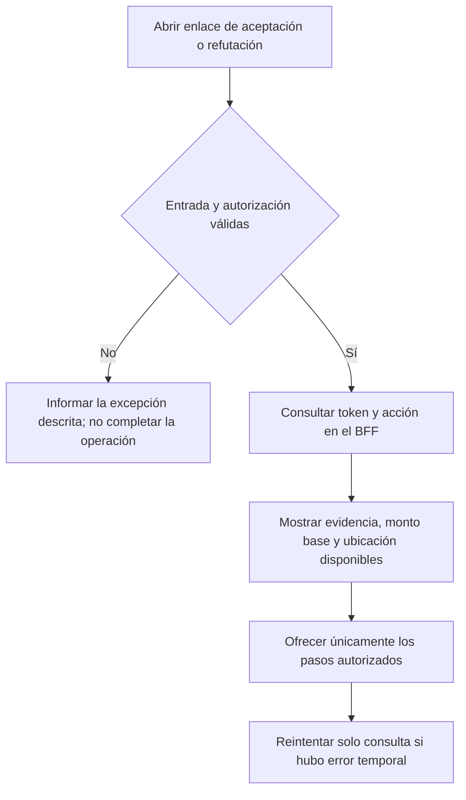

**Excepciones y alternativas**

- Enlace vencido o revocado muestra estado específico.
- Enlace de refutación no habilita aceptar.
- Monto desconocido muestra pendiente, no cero.
- Mapa externo no recibe el token del trámite.

**Objetos y persistencia**

Indirecto: ADMEMETRAVEHICULAR.TB_VIVI_ACCIONES_CORREO, TB_VIVI_DENUNCIAS y TB_VIVI_EVIDENCIAS vía api-portal.

**Archivos involucrados**

- [src/app/api/vivi/aceptaciones/consulta/route.ts](https://github.com/EMETRA/portal-emetra/blob/85ab07b216ef7cccafd28a47aba068520efec8be/src/app/api/vivi/aceptaciones/consulta/route.ts)
- [src/app/api/vivi/denuncias/[id]/evidencias/[evidencia]/route.ts](https://github.com/EMETRA/portal-emetra/blob/85ab07b216ef7cccafd28a47aba068520efec8be/src/app/api/vivi/denuncias/%5Bid%5D/evidencias/%5Bevidencia%5D/route.ts)
- [src/app/api/vivi/denuncias/[id]/route.ts](https://github.com/EMETRA/portal-emetra/blob/85ab07b216ef7cccafd28a47aba068520efec8be/src/app/api/vivi/denuncias/%5Bid%5D/route.ts)
- [src/app/tramite-reporte/[id]/page.tsx](https://github.com/EMETRA/portal-emetra/blob/85ab07b216ef7cccafd28a47aba068520efec8be/src/app/tramite-reporte/%5Bid%5D/page.tsx)
- [src/app/vivi/correo/aceptar/[token]/page.tsx](https://github.com/EMETRA/portal-emetra/blob/85ab07b216ef7cccafd28a47aba068520efec8be/src/app/vivi/correo/aceptar/%5Btoken%5D/page.tsx)
- [src/app/vivi/correo/refutar/[token]/page.tsx](https://github.com/EMETRA/portal-emetra/blob/85ab07b216ef7cccafd28a47aba068520efec8be/src/app/vivi/correo/refutar/%5Btoken%5D/page.tsx)
- [src/schema/vivi.ts](https://github.com/EMETRA/portal-emetra/blob/85ab07b216ef7cccafd28a47aba068520efec8be/src/schema/vivi.ts)

## CU-10 · Aceptar caso VIVI y conservar resultado al reabrir

**Actor:** Visitante o usuario autorizado del servicio.

**Precondiciones y entrada:** Datos de entrada válidos y backend configurado.

**Flujo y resultado**

1. Revisar resumen y acción permitida.
2. Confirmar aceptación.
3. Enviar una sola operación al BFF.
4. Mostrar resultado de aceptación y monto disponible.
5. Reabrir consultando el resultado existente.

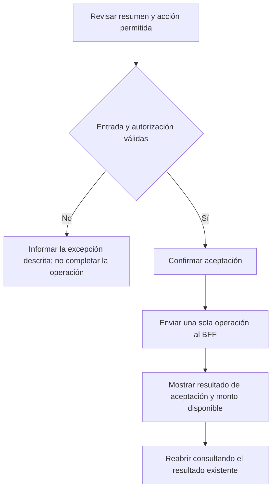

**Excepciones y alternativas**

- Doble clic o dos pestañas no deben duplicar el efecto.
- Error de consulta posterior no implica volver a aceptar.
- Importe final se confirma en el flujo de pago correspondiente.

**Objetos y persistencia**

Indirecto: ADMEMETRAVEHICULAR.TB_VIVI_ACEPTACIONES y emisión de remisión a través del caso de uso de api-portal.

**Archivos involucrados**

- [src/app/api/vivi/aceptaciones/route.ts](https://github.com/EMETRA/portal-emetra/blob/85ab07b216ef7cccafd28a47aba068520efec8be/src/app/api/vivi/aceptaciones/route.ts)
- [src/app/tramite-reporte/[id]/page.tsx](https://github.com/EMETRA/portal-emetra/blob/85ab07b216ef7cccafd28a47aba068520efec8be/src/app/tramite-reporte/%5Bid%5D/page.tsx)
- [src/components/client/organisms/ViviCorreo/ErrorConsulta.tsx](https://github.com/EMETRA/portal-emetra/blob/85ab07b216ef7cccafd28a47aba068520efec8be/src/components/client/organisms/ViviCorreo/ErrorConsulta.tsx)
- [src/components/client/organisms/ViviCorreo/EstadoEnlace.module.scss](https://github.com/EMETRA/portal-emetra/blob/85ab07b216ef7cccafd28a47aba068520efec8be/src/components/client/organisms/ViviCorreo/EstadoEnlace.module.scss)
- [src/components/client/organisms/ViviCorreo/EstadoEnlace.tsx](https://github.com/EMETRA/portal-emetra/blob/85ab07b216ef7cccafd28a47aba068520efec8be/src/components/client/organisms/ViviCorreo/EstadoEnlace.tsx)
- [src/components/client/organisms/ViviCorreo/TramiteReporte.tsx](https://github.com/EMETRA/portal-emetra/blob/85ab07b216ef7cccafd28a47aba068520efec8be/src/components/client/organisms/ViviCorreo/TramiteReporte.tsx)
- [src/components/client/organisms/ViviCorreo/ViviCorreo.module.scss](https://github.com/EMETRA/portal-emetra/blob/85ab07b216ef7cccafd28a47aba068520efec8be/src/components/client/organisms/ViviCorreo/ViviCorreo.module.scss)
- [src/components/client/organisms/ViviCorreo/ViviCorreo.tsx](https://github.com/EMETRA/portal-emetra/blob/85ab07b216ef7cccafd28a47aba068520efec8be/src/components/client/organisms/ViviCorreo/ViviCorreo.tsx)
- [src/components/client/organisms/ViviDefense/ViviDefense.module.scss](https://github.com/EMETRA/portal-emetra/blob/85ab07b216ef7cccafd28a47aba068520efec8be/src/components/client/organisms/ViviDefense/ViviDefense.module.scss)
- [src/components/client/organisms/ViviDefense/ViviDefense.tsx](https://github.com/EMETRA/portal-emetra/blob/85ab07b216ef7cccafd28a47aba068520efec8be/src/components/client/organisms/ViviDefense/ViviDefense.tsx)
- [src/components/client/organisms/ViviDefense/index.tsx](https://github.com/EMETRA/portal-emetra/blob/85ab07b216ef7cccafd28a47aba068520efec8be/src/components/client/organisms/ViviDefense/index.tsx)
- [src/components/client/organisms/ViviDefense/types.tsx](https://github.com/EMETRA/portal-emetra/blob/85ab07b216ef7cccafd28a47aba068520efec8be/src/components/client/organisms/ViviDefense/types.tsx)
- [src/components/client/organisms/ViviDefenseSent/ViviDefenseSent.module.scss](https://github.com/EMETRA/portal-emetra/blob/85ab07b216ef7cccafd28a47aba068520efec8be/src/components/client/organisms/ViviDefenseSent/ViviDefenseSent.module.scss)
- [src/components/client/organisms/ViviDefenseSent/ViviDefenseSent.tsx](https://github.com/EMETRA/portal-emetra/blob/85ab07b216ef7cccafd28a47aba068520efec8be/src/components/client/organisms/ViviDefenseSent/ViviDefenseSent.tsx)
- [src/components/client/organisms/ViviDefenseSent/index.tsx](https://github.com/EMETRA/portal-emetra/blob/85ab07b216ef7cccafd28a47aba068520efec8be/src/components/client/organisms/ViviDefenseSent/index.tsx)
- [src/components/client/organisms/ViviDefenseSent/types.tsx](https://github.com/EMETRA/portal-emetra/blob/85ab07b216ef7cccafd28a47aba068520efec8be/src/components/client/organisms/ViviDefenseSent/types.tsx)
- [src/schema/vivi.ts](https://github.com/EMETRA/portal-emetra/blob/85ab07b216ef7cccafd28a47aba068520efec8be/src/schema/vivi.ts)

## CU-11 · Consultar formulario y documentos de defensa VIVI; compatibilidad heredada

**Actor:** Visitante o usuario autorizado del servicio.

**Precondiciones y entrada:** Datos de entrada válidos y backend configurado.

**Flujo y resultado**

1. Abrir defensa con enlace autorizado.
2. Consultar o descargar plantilla y documentos permitidos.
3. Distinguir la pantalla heredada de presentación web.
4. Atender el rechazo HTTP 410 del API actual y seguir presentación presencial.

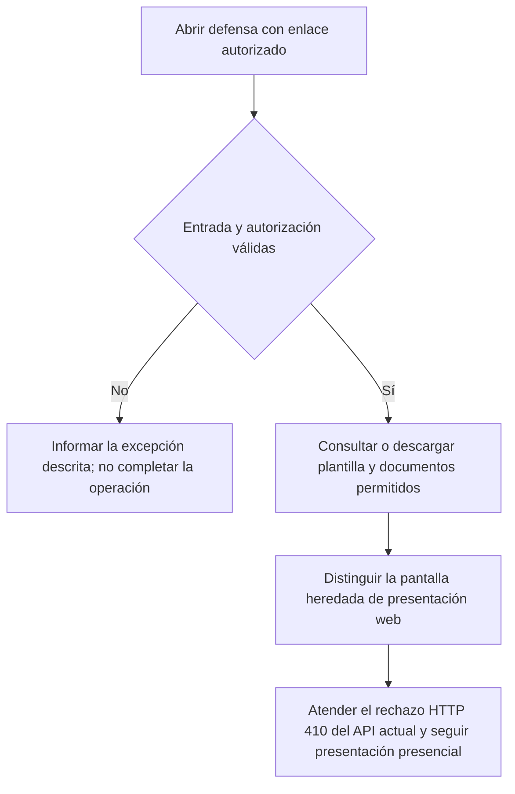

**Excepciones y alternativas**

- El formulario heredado no acredita que el backend permita presentar online.
- API actual bloquea POST con HTTP 410 antes de adjuntos.
- La descarga de documentos existentes sigue su autorización propia; no duplicar una presentación.

**Objetos y persistencia**

Indirecto: ADMEMETRAVEHICULAR.TB_VIVI_DEFENSAS y TB_VIVI_DOCUMENTOS mediante api-portal; almacenamiento privado.

**Archivos involucrados**

- [src/app/api/vivi/defensas/[id]/documento/route.ts](https://github.com/EMETRA/portal-emetra/blob/85ab07b216ef7cccafd28a47aba068520efec8be/src/app/api/vivi/defensas/%5Bid%5D/documento/route.ts)
- [src/app/api/vivi/defensas/consulta/route.ts](https://github.com/EMETRA/portal-emetra/blob/85ab07b216ef7cccafd28a47aba068520efec8be/src/app/api/vivi/defensas/consulta/route.ts)
- [src/app/api/vivi/defensas/plantilla/route.ts](https://github.com/EMETRA/portal-emetra/blob/85ab07b216ef7cccafd28a47aba068520efec8be/src/app/api/vivi/defensas/plantilla/route.ts)
- [src/app/api/vivi/denuncias/[id]/defensa/route.ts](https://github.com/EMETRA/portal-emetra/blob/85ab07b216ef7cccafd28a47aba068520efec8be/src/app/api/vivi/denuncias/%5Bid%5D/defensa/route.ts)
- [src/app/tramite-reporte/[id]/defensa/page.tsx](https://github.com/EMETRA/portal-emetra/blob/85ab07b216ef7cccafd28a47aba068520efec8be/src/app/tramite-reporte/%5Bid%5D/defensa/page.tsx)
- [src/schema/vivi.ts](https://github.com/EMETRA/portal-emetra/blob/85ab07b216ef7cccafd28a47aba068520efec8be/src/schema/vivi.ts)

## Índice de operaciones y rutas

Las carpetas entre paréntesis agrupan rutas App Router sin añadirse a la URL; `[id]` y segmentos equivalentes son parámetros. Los BFF son intermediarios del mismo origen y no acceden por sí mismos a Oracle.

| Tipo | Archivo / ruta | Caso |
| --- | --- | --- |
| Pantalla | [src/app/(services)/enviar-resolucion/[juzgado]/page.tsx](https://github.com/EMETRA/portal-emetra/blob/85ab07b216ef7cccafd28a47aba068520efec8be/src/app/%28services%29/enviar-resolucion/%5Bjuzgado%5D/page.tsx) | [CU-06](#cu-06) |
| Pantalla | [src/app/(services)/juzgado/page.tsx](https://github.com/EMETRA/portal-emetra/blob/85ab07b216ef7cccafd28a47aba068520efec8be/src/app/%28services%29/juzgado/page.tsx) | [CU-06](#cu-06) |
| Pantalla | [src/app/(services)/notificaciones/page.tsx](https://github.com/EMETRA/portal-emetra/blob/85ab07b216ef7cccafd28a47aba068520efec8be/src/app/%28services%29/notificaciones/page.tsx) | [CU-05](#cu-05) |
| Pantalla | [src/app/(services)/solvencia/page.tsx](https://github.com/EMETRA/portal-emetra/blob/85ab07b216ef7cccafd28a47aba068520efec8be/src/app/%28services%29/solvencia/page.tsx) | [CU-04](#cu-04) |
| Pantalla | [src/app/auth/page.tsx](https://github.com/EMETRA/portal-emetra/blob/85ab07b216ef7cccafd28a47aba068520efec8be/src/app/auth/page.tsx) | [CU-08](#cu-08) |
| Pantalla | [src/app/desplazamiento/page.tsx](https://github.com/EMETRA/portal-emetra/blob/85ab07b216ef7cccafd28a47aba068520efec8be/src/app/desplazamiento/page.tsx) | [CU-03](#cu-03) |
| Pantalla | [src/app/noticias/[slug]/page.tsx](https://github.com/EMETRA/portal-emetra/blob/85ab07b216ef7cccafd28a47aba068520efec8be/src/app/noticias/%5Bslug%5D/page.tsx) | [CU-01](#cu-01) |
| Pantalla | [src/app/notificaciones-sat/page.tsx](https://github.com/EMETRA/portal-emetra/blob/85ab07b216ef7cccafd28a47aba068520efec8be/src/app/notificaciones-sat/page.tsx) | [CU-05](#cu-05) |
| Pantalla | [src/app/predice/[id]/page.tsx](https://github.com/EMETRA/portal-emetra/blob/85ab07b216ef7cccafd28a47aba068520efec8be/src/app/predice/%5Bid%5D/page.tsx) | [CU-02](#cu-02) |
| Pantalla | [src/app/predice/nuevo/page.tsx](https://github.com/EMETRA/portal-emetra/blob/85ab07b216ef7cccafd28a47aba068520efec8be/src/app/predice/nuevo/page.tsx) | [CU-02](#cu-02) |
| Pantalla | [src/app/predice/page.tsx](https://github.com/EMETRA/portal-emetra/blob/85ab07b216ef7cccafd28a47aba068520efec8be/src/app/predice/page.tsx) | [CU-02](#cu-02) |
| Pantalla | [src/app/sumate/page.tsx](https://github.com/EMETRA/portal-emetra/blob/85ab07b216ef7cccafd28a47aba068520efec8be/src/app/sumate/page.tsx) | [CU-07](#cu-07) |
| Pantalla | [src/app/tramite-reporte/[id]/defensa/page.tsx](https://github.com/EMETRA/portal-emetra/blob/85ab07b216ef7cccafd28a47aba068520efec8be/src/app/tramite-reporte/%5Bid%5D/defensa/page.tsx) | [CU-11](#cu-11) |
| Pantalla | [src/app/tramite-reporte/[id]/page.tsx](https://github.com/EMETRA/portal-emetra/blob/85ab07b216ef7cccafd28a47aba068520efec8be/src/app/tramite-reporte/%5Bid%5D/page.tsx) | [CU-09](#cu-09) |
| Pantalla | [src/app/vivi/correo/aceptar/[token]/page.tsx](https://github.com/EMETRA/portal-emetra/blob/85ab07b216ef7cccafd28a47aba068520efec8be/src/app/vivi/correo/aceptar/%5Btoken%5D/page.tsx) | [CU-09](#cu-09) |
| Pantalla | [src/app/vivi/correo/refutar/[token]/page.tsx](https://github.com/EMETRA/portal-emetra/blob/85ab07b216ef7cccafd28a47aba068520efec8be/src/app/vivi/correo/refutar/%5Btoken%5D/page.tsx) | [CU-09](#cu-09) |
| BFF | [src/app/api/auth/session/route.ts](https://github.com/EMETRA/portal-emetra/blob/85ab07b216ef7cccafd28a47aba068520efec8be/src/app/api/auth/session/route.ts) | [CU-08](#cu-08) |
| BFF | [src/app/api/contact/route.ts](https://github.com/EMETRA/portal-emetra/blob/85ab07b216ef7cccafd28a47aba068520efec8be/src/app/api/contact/route.ts) | [CU-07](#cu-07) |
| BFF | [src/app/api/faq/route.ts](https://github.com/EMETRA/portal-emetra/blob/85ab07b216ef7cccafd28a47aba068520efec8be/src/app/api/faq/route.ts) | [CU-01](#cu-01) |
| BFF | [src/app/api/health/backend/route.ts](https://github.com/EMETRA/portal-emetra/blob/85ab07b216ef7cccafd28a47aba068520efec8be/src/app/api/health/backend/route.ts) | [CU-08](#cu-08) |
| BFF | [src/app/api/juzgado/consultar/route.ts](https://github.com/EMETRA/portal-emetra/blob/85ab07b216ef7cccafd28a47aba068520efec8be/src/app/api/juzgado/consultar/route.ts) | [CU-06](#cu-06) |
| BFF | [src/app/api/juzgado/registrar/route.ts](https://github.com/EMETRA/portal-emetra/blob/85ab07b216ef7cccafd28a47aba068520efec8be/src/app/api/juzgado/registrar/route.ts) | [CU-06](#cu-06) |
| BFF | [src/app/api/juzgado/remisiones/route.ts](https://github.com/EMETRA/portal-emetra/blob/85ab07b216ef7cccafd28a47aba068520efec8be/src/app/api/juzgado/remisiones/route.ts) | [CU-06](#cu-06) |
| BFF | [src/app/api/notificaciones/desuscripcion/route.ts](https://github.com/EMETRA/portal-emetra/blob/85ab07b216ef7cccafd28a47aba068520efec8be/src/app/api/notificaciones/desuscripcion/route.ts) | [CU-07](#cu-07) |
| BFF | [src/app/api/notificaciones/suscripcion/route.ts](https://github.com/EMETRA/portal-emetra/blob/85ab07b216ef7cccafd28a47aba068520efec8be/src/app/api/notificaciones/suscripcion/route.ts) | [CU-07](#cu-07) |
| BFF | [src/app/api/predice/eventos/[id]/route.ts](https://github.com/EMETRA/portal-emetra/blob/85ab07b216ef7cccafd28a47aba068520efec8be/src/app/api/predice/eventos/%5Bid%5D/route.ts) | [CU-02](#cu-02) |
| BFF | [src/app/api/predice/eventos/route.ts](https://github.com/EMETRA/portal-emetra/blob/85ab07b216ef7cccafd28a47aba068520efec8be/src/app/api/predice/eventos/route.ts) | [CU-02](#cu-02) |
| BFF | [src/app/api/public-news/[slug]/route.ts](https://github.com/EMETRA/portal-emetra/blob/85ab07b216ef7cccafd28a47aba068520efec8be/src/app/api/public-news/%5Bslug%5D/route.ts) | [CU-01](#cu-01) |
| BFF | [src/app/api/public-news/route.ts](https://github.com/EMETRA/portal-emetra/blob/85ab07b216ef7cccafd28a47aba068520efec8be/src/app/api/public-news/route.ts) | [CU-01](#cu-01) |
| BFF | [src/app/api/public-news/uploads/[...path]/route.ts](https://github.com/EMETRA/portal-emetra/blob/85ab07b216ef7cccafd28a47aba068520efec8be/src/app/api/public-news/uploads/%5B...path%5D/route.ts) | [CU-01](#cu-01) |
| BFF | [src/app/api/routes/[id]/route.ts](https://github.com/EMETRA/portal-emetra/blob/85ab07b216ef7cccafd28a47aba068520efec8be/src/app/api/routes/%5Bid%5D/route.ts) | [CU-03](#cu-03) |
| BFF | [src/app/api/routes/route.ts](https://github.com/EMETRA/portal-emetra/blob/85ab07b216ef7cccafd28a47aba068520efec8be/src/app/api/routes/route.ts) | [CU-03](#cu-03) |
| BFF | [src/app/api/sat/consulta/route.ts](https://github.com/EMETRA/portal-emetra/blob/85ab07b216ef7cccafd28a47aba068520efec8be/src/app/api/sat/consulta/route.ts) | [CU-05](#cu-05) |
| BFF | [src/app/api/sat/getpdf/route.ts](https://github.com/EMETRA/portal-emetra/blob/85ab07b216ef7cccafd28a47aba068520efec8be/src/app/api/sat/getpdf/route.ts) | [CU-05](#cu-05) |
| BFF | [src/app/api/sat/pdf/route.ts](https://github.com/EMETRA/portal-emetra/blob/85ab07b216ef7cccafd28a47aba068520efec8be/src/app/api/sat/pdf/route.ts) | [CU-05](#cu-05) |
| BFF | [src/app/api/solvencia/get-data/route.ts](https://github.com/EMETRA/portal-emetra/blob/85ab07b216ef7cccafd28a47aba068520efec8be/src/app/api/solvencia/get-data/route.ts) | [CU-04](#cu-04) |
| BFF | [src/app/api/solvencia/pdf/route.ts](https://github.com/EMETRA/portal-emetra/blob/85ab07b216ef7cccafd28a47aba068520efec8be/src/app/api/solvencia/pdf/route.ts) | [CU-04](#cu-04) |
| BFF | [src/app/api/solvencia/recibo-pdf/route.ts](https://github.com/EMETRA/portal-emetra/blob/85ab07b216ef7cccafd28a47aba068520efec8be/src/app/api/solvencia/recibo-pdf/route.ts) | [CU-04](#cu-04) |
| BFF | [src/app/api/solvencia/recibo/route.ts](https://github.com/EMETRA/portal-emetra/blob/85ab07b216ef7cccafd28a47aba068520efec8be/src/app/api/solvencia/recibo/route.ts) | [CU-04](#cu-04) |
| BFF | [src/app/api/solvencia/validar/route.ts](https://github.com/EMETRA/portal-emetra/blob/85ab07b216ef7cccafd28a47aba068520efec8be/src/app/api/solvencia/validar/route.ts) | [CU-04](#cu-04) |
| BFF | [src/app/api/vivi/aceptaciones/consulta/route.ts](https://github.com/EMETRA/portal-emetra/blob/85ab07b216ef7cccafd28a47aba068520efec8be/src/app/api/vivi/aceptaciones/consulta/route.ts) | [CU-09](#cu-09) |
| BFF | [src/app/api/vivi/aceptaciones/route.ts](https://github.com/EMETRA/portal-emetra/blob/85ab07b216ef7cccafd28a47aba068520efec8be/src/app/api/vivi/aceptaciones/route.ts) | [CU-10](#cu-10) |
| BFF | [src/app/api/vivi/defensas/[id]/documento/route.ts](https://github.com/EMETRA/portal-emetra/blob/85ab07b216ef7cccafd28a47aba068520efec8be/src/app/api/vivi/defensas/%5Bid%5D/documento/route.ts) | [CU-11](#cu-11) |
| BFF | [src/app/api/vivi/defensas/consulta/route.ts](https://github.com/EMETRA/portal-emetra/blob/85ab07b216ef7cccafd28a47aba068520efec8be/src/app/api/vivi/defensas/consulta/route.ts) | [CU-11](#cu-11) |
| BFF | [src/app/api/vivi/defensas/plantilla/route.ts](https://github.com/EMETRA/portal-emetra/blob/85ab07b216ef7cccafd28a47aba068520efec8be/src/app/api/vivi/defensas/plantilla/route.ts) | [CU-11](#cu-11) |
| BFF | [src/app/api/vivi/denuncias/[id]/defensa/route.ts](https://github.com/EMETRA/portal-emetra/blob/85ab07b216ef7cccafd28a47aba068520efec8be/src/app/api/vivi/denuncias/%5Bid%5D/defensa/route.ts) | [CU-11](#cu-11) |
| BFF | [src/app/api/vivi/denuncias/[id]/evidencias/[evidencia]/route.ts](https://github.com/EMETRA/portal-emetra/blob/85ab07b216ef7cccafd28a47aba068520efec8be/src/app/api/vivi/denuncias/%5Bid%5D/evidencias/%5Bevidencia%5D/route.ts) | [CU-09](#cu-09) |
| BFF | [src/app/api/vivi/denuncias/[id]/route.ts](https://github.com/EMETRA/portal-emetra/blob/85ab07b216ef7cccafd28a47aba068520efec8be/src/app/api/vivi/denuncias/%5Bid%5D/route.ts) | [CU-09](#cu-09) |

## Criterios de cobertura

Esta edición contiene **11 casos agrupados**. El inventario incluye 0 entradas Nest decoradas, 16 páginas Next y 32 manejadores BFF, según corresponda. Los procesos internos, servicios asíncronos y almacenamiento local se cubren en los casos aunque no expongan HTTP. Las operaciones heredadas se identifican como tales; una ruta conservada en código no implica que deba aparecer habilitada en el catálogo de aplicaciones. Las funciones pendientes no se presentan como implementadas.

Para mantener la cobertura: al añadir o retirar una ruta, resolver, tarea programada o pantalla, actualizar su caso, su fila en este índice, los objetos usados y el diagrama. Si una función depende de otro repositorio, conservar explícito ese límite y actualizar también el contrato del receptor.

## Ampliación EVIAL

Referencia de código de los siguientes casos: `92173243e32ee550929fc1ea37e52e013f75fd7b`. Preparado sin conexión institucional; los flujos del API usan sus objetos existentes, sin crear ni migrar tablas.

## CU-12 · Explorar capacitaciones EVIAL

**Actor y alcance:** Visitante.

**Flujo y resultado**

1. Abrir Educación vial desde navegación/servicios.
2. Consultar catálogo y detalle; revisar fechas, modalidad, requisitos, beneficios y programación.
3. Elegir inscripción o acceso con código; conservar enlaces /events/:id existentes.

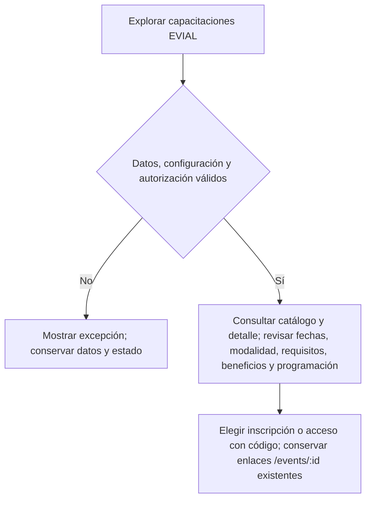

**Excepciones y alternativas:** Carga, catálogo vacío y error disponen de estados propios sin datos ficticios. Las rutas de IDs inválidos no abren expedientes. Los medios actuales necesitan conservar su alojamiento.

**Objetos de datos:** TB_EVENTO_EVIAL; TB_REQUISITOS_EVENTO_EVIAL; TB_REGLAS_EVENTO_EVIAL; TB_BENEFICIOS_EVENTO_EVIAL; TB_ACTIVIDADES_EVENTO_EVIAL; TB_MARCAS_EVENTO_EVIAL; TB_VIDEOS_EVIAL; TB_PREGUNTAS_FRECUENTES_EVIAL; catálogos de geografía existentes. El frontend los utiliza a través de api-portal; no abre sesiones Oracle.

**Archivos involucrados:** [src/components/client/evial/EvialHome.tsx](https://github.com/EMETRA/portal-emetra/blob/92173243e32ee550929fc1ea37e52e013f75fd7b/src/components/client/evial/EvialHome.tsx), [src/components/client/evial/EvialEventDetail.tsx](https://github.com/EMETRA/portal-emetra/blob/92173243e32ee550929fc1ea37e52e013f75fd7b/src/components/client/evial/EvialEventDetail.tsx), [src/app/events/[id]/page.tsx](https://github.com/EMETRA/portal-emetra/blob/92173243e32ee550929fc1ea37e52e013f75fd7b/src/app/events/[id]/page.tsx).

## CU-13 · Inscribirse y recuperar acceso al curso

**Actor y alcance:** Participante.

**Flujo y resultado**

1. Verificar disponibilidad antes de solicitar datos.
2. Completar datos personales/residencia/placa; S usa datos de inscripción previa.
3. Confirmar inscripción o entrar con código, DPI y teléfono.
4. Recibir cookie HttpOnly de curso y abrir mi capacitación.

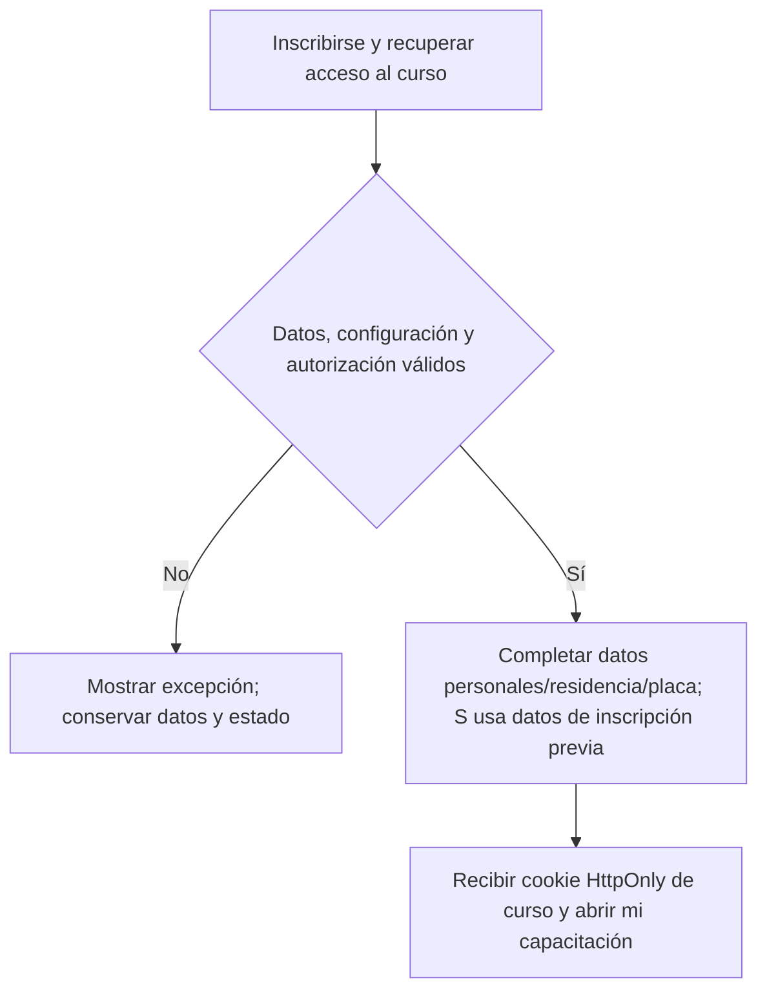

**Excepciones y alternativas:** Datos no válidos se señalan antes de enviar cuando es posible. Error del API conserva el formulario. Cupos y aprobación se comprueban en el servidor. Sin configuración se bloquea el proceso antes de llenarlo.

**Objetos de datos:** TB_EVENTO_EVIAL; TB_PERSONAS_EVIAL; TB_INSCRIPCION_EVENTO_EVIAL; SEQ_PERSONA_EVIAL. El frontend los utiliza a través de api-portal; no abre sesiones Oracle.

**Archivos involucrados:** [src/components/client/evial/EvialEventDetail.tsx](https://github.com/EMETRA/portal-emetra/blob/92173243e32ee550929fc1ea37e52e013f75fd7b/src/components/client/evial/EvialEventDetail.tsx), [src/lib/evial/proxy.ts](https://github.com/EMETRA/portal-emetra/blob/92173243e32ee550929fc1ea37e52e013f75fd7b/src/lib/evial/proxy.ts), [src/lib/evial/types.ts](https://github.com/EMETRA/portal-emetra/blob/92173243e32ee550929fc1ea37e52e013f75fd7b/src/lib/evial/types.ts).

## CU-14 · Estudiar materiales y completar examen

**Actor y alcance:** Participante con cookie de curso propia.

**Flujo y resultado**

1. Abrir materiales y marcarlos como revisados en la interfaz.
2. Solicitar intento al API; recorrer preguntas con temporizador de dos minutos.
3. Enviar respuestas del intento firmado y consultar nota/etapas desde el servidor.
4. Continuar actividad o consultar al personal si agotó dos intentos.

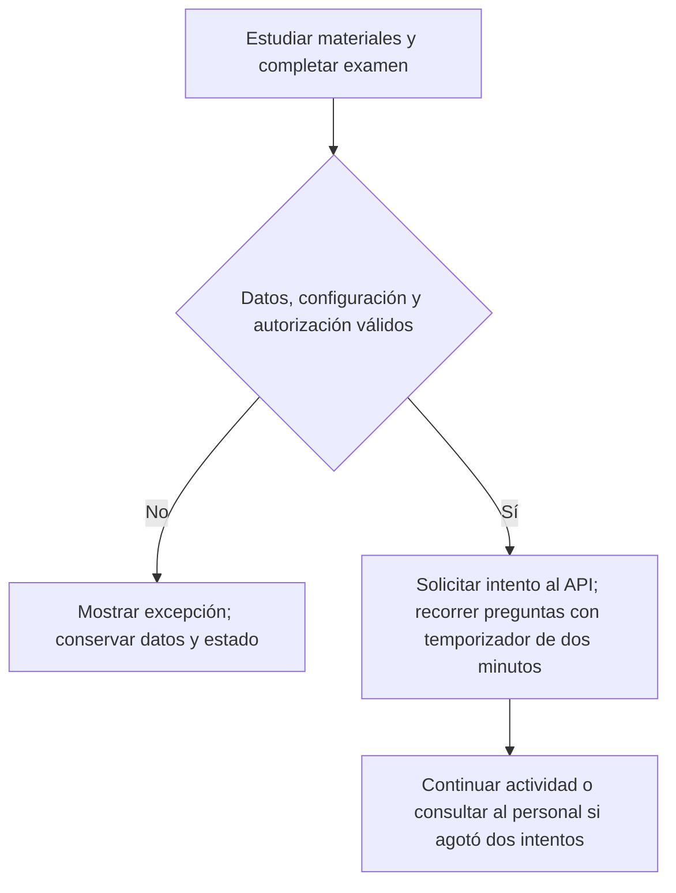

**Excepciones y alternativas:** No se revela banco de respuestas correctas. La marca local Revisado no prueba lectura. Error de envío conserva las respuestas para consultar/reintentar; la idempotencia se decide en el API. Sesión vencida pide acceso otra vez.

**Objetos de datos:** TB_INSCRIPCION_EVENTO_EVIAL; TB_EVENTO_EVIAL; TB_ACTIVIDADES_EVENTO_EVIAL; TB_CONTENIDO_EVIAL; TB_ENCA_PREGUNTAS_EVIAL; TB_OPCIONES_PREGUNTA_EVIAL; TB_RESPUESTAS_PREGUNTA_EVIAL; TB_TESTS_PERSONA_EVIAL; TB_DETALLE_TEST_EVIAL. El frontend los utiliza a través de api-portal; no abre sesiones Oracle.

**Archivos involucrados:** [src/components/client/evial/EvialCourse.tsx](https://github.com/EMETRA/portal-emetra/blob/92173243e32ee550929fc1ea37e52e013f75fd7b/src/components/client/evial/EvialCourse.tsx), [src/lib/evial/types.ts](https://github.com/EMETRA/portal-emetra/blob/92173243e32ee550929fc1ea37e52e013f75fd7b/src/lib/evial/types.ts), [src/lib/evial/proxy.ts](https://github.com/EMETRA/portal-emetra/blob/92173243e32ee550929fc1ea37e52e013f75fd7b/src/lib/evial/proxy.ts).

## CU-15 · Abrir comprobante y solicitar correo

**Actor y alcance:** Participante inscrito.

**Flujo y resultado**

1. Abrir PDF propio mediante BFF autenticado.
2. Conservar comprobante y QR para la asistencia.
3. Solicitar correo registrado solo cuando está habilitado; mostrar resultado SMTP.

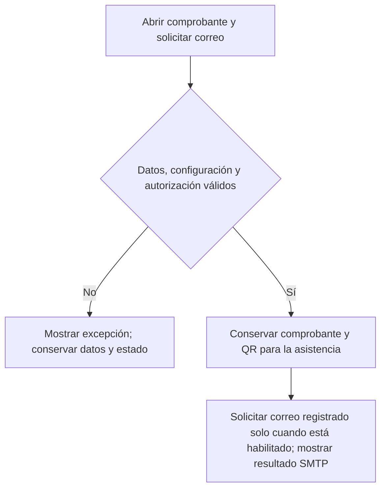

**Excepciones y alternativas:** Sin correo/remitente no se puede enviar y el PDF sigue disponible. No se permite elegir otro destinatario desde el navegador. Descargar no envía y el comprobante no autoriza descuento.

**Objetos de datos:** TB_INSCRIPCION_EVENTO_EVIAL; TB_PERSONAS_EVIAL; TB_EVENTO_EVIAL; almacenamiento en memoria para PDF y SMTP existente. El frontend los utiliza a través de api-portal; no abre sesiones Oracle.

**Archivos involucrados:** [src/components/client/evial/EvialCourse.tsx](https://github.com/EMETRA/portal-emetra/blob/92173243e32ee550929fc1ea37e52e013f75fd7b/src/components/client/evial/EvialCourse.tsx), [src/lib/evial/proxy.ts](https://github.com/EMETRA/portal-emetra/blob/92173243e32ee550929fc1ea37e52e013f75fd7b/src/lib/evial/proxy.ts), [src/app/api/evial/[...path]/route.ts](https://github.com/EMETRA/portal-emetra/blob/92173243e32ee550929fc1ea37e52e013f75fd7b/src/app/api/evial/[...path]/route.ts).

## CU-16 · Compartir formación y evaluar por enlace individual

**Actor y alcance:** Participante aprobado y cinco alumnos.

**Flujo y resultado**

1. Registrar cinco alumnos y adjuntar foto/video por multipart.
2. Copiar cada enlace firmado y compartirlo únicamente con su participante.
3. Abrir enlace, retirar fragmento de la barra y responder preguntas de texto libre.
4. Confirmar registro sin permitir modificar evaluaciones ya recibidas.

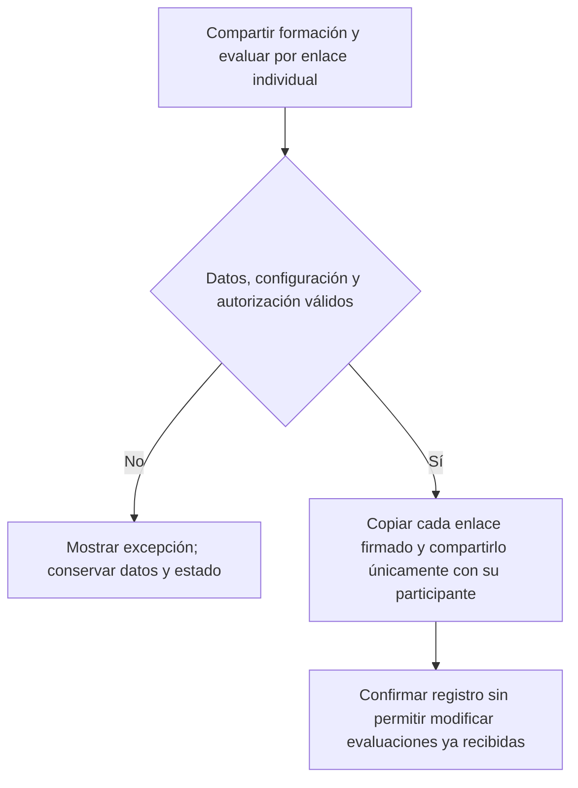

**Excepciones y alternativas:** No se guardan tokens en localStorage ni se envía correo automático a los cinco alumnos. Enlace inválido/vencido requiere regenerarlo desde el curso. Ausencia de evidencia configurada bloquea antes de completar datos. No aparecen alumnos de otra inscripción.

**Objetos de datos:** TB_ALUMNOS_PERSONA_EVIAL; TB_PREGUNTA_EVALUA_EVIAL; TB_EVALUA_MAESTRO_EVIAL; TB_PERSONAS_EVIAL.RUTA_FOTO; TB_INSCRIPCION_EVENTO_EVIAL; volumen privado. El frontend los utiliza a través de api-portal; no abre sesiones Oracle.

**Archivos involucrados:** [src/components/client/evial/EvialCourse.tsx](https://github.com/EMETRA/portal-emetra/blob/92173243e32ee550929fc1ea37e52e013f75fd7b/src/components/client/evial/EvialCourse.tsx), [src/components/client/evial/EvialEvaluation.tsx](https://github.com/EMETRA/portal-emetra/blob/92173243e32ee550929fc1ea37e52e013f75fd7b/src/components/client/evial/EvialEvaluation.tsx), [src/lib/evial/proxy.ts](https://github.com/EMETRA/portal-emetra/blob/92173243e32ee550929fc1ea37e52e013f75fd7b/src/lib/evial/proxy.ts).

## CU-17 · Consultar participantes, QR y asistencia del personal

**Actor y alcance:** Personal autorizado.

**Flujo y resultado**

1. Acceder con cuenta institucional y Turnstile.
2. Ver capacidades antes de mostrar formularios y buscar mediante POST.
3. Seleccionar participante manualmente o con cámara QR.
4. Confirmar paso de asistencia y utilizar correcciones/retirada solo con permiso adicional.

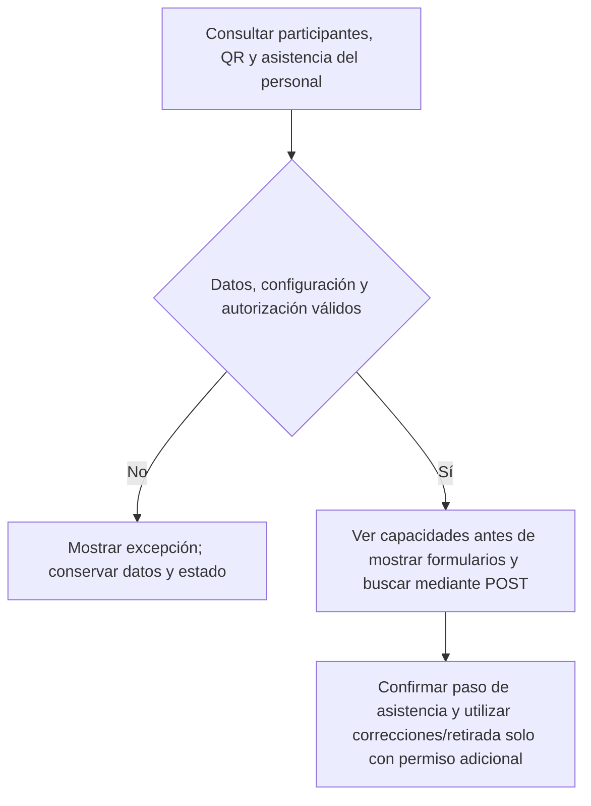

**Excepciones y alternativas:** Una cuenta sin acceso no llena procesos administrativos. Cámara denegada ofrece búsqueda manual y se libera al cerrar. Leer QR no guarda. Cookies de curso/personal no se sustituyen entre sí. Errores muestran referencia sin SQL ni secretos.

**Objetos de datos:** TB_PERSONAS_EVIAL; TB_INSCRIPCION_EVENTO_EVIAL; TB_TESTS_PERSONA_EVIAL; TB_EVENTO_EVIAL. Identidad/permisos en api-autenticacion; no se modifican sus catálogos desde EVIAL. El frontend los utiliza a través de api-portal; no abre sesiones Oracle.

**Archivos involucrados:** [src/components/client/evial/EvialManagement.tsx](https://github.com/EMETRA/portal-emetra/blob/92173243e32ee550929fc1ea37e52e013f75fd7b/src/components/client/evial/EvialManagement.tsx), [src/components/client/evial/EvialCaptcha.tsx](https://github.com/EMETRA/portal-emetra/blob/92173243e32ee550929fc1ea37e52e013f75fd7b/src/components/client/evial/EvialCaptcha.tsx), [src/components/client/evial/EvialScanner.tsx](https://github.com/EMETRA/portal-emetra/blob/92173243e32ee550929fc1ea37e52e013f75fd7b/src/components/client/evial/EvialScanner.tsx), [src/lib/evial/proxy.ts](https://github.com/EMETRA/portal-emetra/blob/92173243e32ee550929fc1ea37e52e013f75fd7b/src/lib/evial/proxy.ts).

## CU-18 · Editar capacitación y materiales

**Actor y alcance:** Personal con capacidad administrativa.

**Flujo y resultado**

1. Abrir editor desde gestión o crear capacitación inactiva.
2. Editar datos, fechas, cupo y modalidad; confirmar guardar.
3. Agregar/editar material por módulo con URL HTTPS.
4. Refrescar los datos confirmados del API.

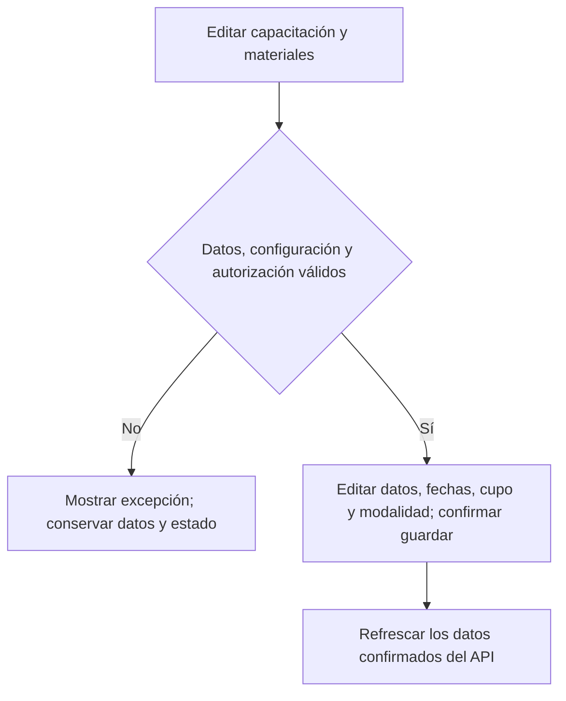

**Excepciones y alternativas:** No se ofrece edición sin permiso. No se publican bancos/preguntas inventados. Requisitos y otros catálogos Oracle siguen su mantenimiento existente. Error conserva datos y requiere consultar estado antes de repetir una creación.

**Objetos de datos:** TB_EVENTO_EVIAL; TB_INSCRIPCION_EVENTO_EVIAL; TB_CONTENIDO_EVIAL; TB_EVENTO_EVIAL_SEQ; TB_CONTENIDO_EVIAL_SEQ. Referencias de módulo existentes. El frontend los utiliza a través de api-portal; no abre sesiones Oracle.

**Archivos involucrados:** [src/components/client/evial/EvialEditor.tsx](https://github.com/EMETRA/portal-emetra/blob/92173243e32ee550929fc1ea37e52e013f75fd7b/src/components/client/evial/EvialEditor.tsx), [src/components/client/evial/EvialManagement.tsx](https://github.com/EMETRA/portal-emetra/blob/92173243e32ee550929fc1ea37e52e013f75fd7b/src/components/client/evial/EvialManagement.tsx), [src/lib/evial/proxy.ts](https://github.com/EMETRA/portal-emetra/blob/92173243e32ee550929fc1ea37e52e013f75fd7b/src/lib/evial/proxy.ts).
