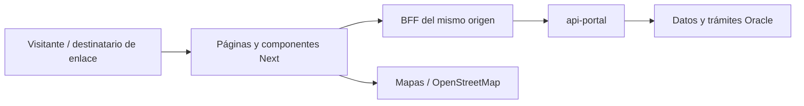

# Manual técnico — portal-emetra

Código de referencia: `85ab07b216ef7cccafd28a47aba068520efec8be`; línea de integración revisada: `estado-recuperado`. Describe capacidades presentes en esa revisión; la configuración y las autorizaciones efectivas de un servidor se comprueban por separado. Esta edición se preparó sin conectarse a Oracle, SMTP ni servidores institucionales.

Los enlaces de código fijan esa revisión para que sigan siendo consultables cuando `main` excluya herramientas de desarrollo. Al modificar un comportamiento se deben actualizar su caso de uso, configuración y referencia de código.


## Índice

- [1. Propósito y límites](#orientacion)
- [2. Arquitectura y dependencias](#arquitectura)
- [3. Organización de carpetas](#organizacion)
- [4. Patrones, nomenclatura y estilo](#convenciones)
- [5. Preparación y configuración](#configuracion)
- [6. Datos y transacciones](#datos)
- [7. Autenticación, permisos y privacidad](#seguridad)
- [8. Operación, fallos y recuperación](#operacion)
- [9. Validación y mantenimiento](#validacion)
- [10. Ramas y documentos de producción](#promocion)
- [11. Índice de configuración](#variables)
- [12. Índice de persistencia](#objetos)

Casos funcionales y recorridos: [casos-de uso.md](casos-de%20uso.md).

<a id="orientacion"></a>

## 1. Propósito y límites

Sitio web público institucional: noticias, FAQ, mapas de Predice y rutas, formularios de servicios, notificaciones y trámites VIVI de aceptación/defensa. Esta edición describe la versión funcional integrada en `estado-recuperado`; no el esqueleto antiguo de QA.

<a id="arquitectura"></a>

## 2. Arquitectura y dependencias

`next 15.3.5`, `react ^19.0.0`.

Next15 App Router con componentes cliente/servidor, SCSS Modules y composición de UI. Los route handlers de `src/app/api` son BFF hacia api-portal: centralizan URL, cabeceras, timeout y normalización de fallos. El trámite VIVI combina pantallas y endpoints propios del BFF con autorización por enlace del backend. Leaflet y OpenStreetMap muestran rutas y ubicaciones; generar un enlace a coordenadas no consulta un geocodificador ni modifica el caso.




<a id="organizacion"></a>

## 3. Organización de carpetas

| Ubicación | Responsabilidad |
| --- | --- |
| `src/app` | Rutas públicas, servicios y BFF |
| `src/components` | UI, formularios, mapas y composición server/client |
| `src/lib/backend` | Construcción de URL, cabeceras y manejo de upstream |
| `src/schema` | Validación de formularios y contrato VIVI |
| `src/data` | Modelos y hooks de datos |
| `public` | Recursos públicos del sitio |
| `test` | Contratos de integración de trámites, disponibles en la rama de trabajo |

<a id="convenciones"></a>

## 4. Patrones, nomenclatura y estilo

PascalCase en componentes; carpetas y rutas según App Router; hooks `useX`; esquemas de formulario separados en `src/schema`; estilos `.module.scss`. Mantener componentes server sin interacción y declarar client cuando se necesita estado, DOM o mapas. Conservar helpers de enlace VIVI, monto y errores para que resumen, confirmación y caso aceptado muestren el mismo contrato. Un valor monetario cero es distinto de importe desconocido. URLs externas solo se construyen con protocolos y datos permitidos.

Para una modificación: localizar el caso en [casos-de uso.md](casos-de%20uso.md), seguir sus entradas hasta el servicio/adaptador, modificar contrato y validación juntos y mantener la nomenclatura de los archivos cercanos. Evitar trasladar reglas de autorización a controles visuales. Las reglas indicadas aquí describen las convenciones dominantes y las pautas que deben conservar los cambios nuevos; no presuponen uniformidad del código heredado.

<a id="configuracion"></a>

## 5. Preparación y configuración

Usar pnpm10.11.0 y el Node del Dockerfile; conservar `pnpm-lock.yaml`.

```bash
corepack pnpm install --frozen-lockfile
corepack pnpm build
```

Configurar el destino del backend y autenticación interna revisando `src/lib/backend/client.ts`, `fetch-upstream.ts` y los handlers, sin copiar tokens al navegador. Los valores `NEXT_PUBLIC_*` se incorporan al bundle. El sitio y api-portal deben usar el mismo entorno de publicación para enlaces VIVI y noticias. El proxy puede tener prefijos propios: comprobar URLs internas del contenedor y URL pública por separado. Preservar configuración/volúmenes del Compose desplegado; no reemplazar una instalación funcional con la antigua QA por el nombre de la rama.

Los siguientes comandos son las entradas reales de `package.json`; el listado no es una secuencia que deba ejecutarse completa. Los comandos de semillas, migración, backfill, publicación y envío tienen efectos y se seleccionan según el entorno.

| Script | Comando declarado |
| --- | --- |
| `dev` | `next dev` |
| `build` | `next build` |
| `start` | `next start` |
| `lint` | `next lint` |
| `storybook` | `storybook dev -p 6006` |
| `build-storybook` | `storybook build` |
| `docker:build` | `pnpm install --frozen-lockfile && docker compose build` |
| `docker:up` | `pnpm install --frozen-lockfile && docker compose up -d --build` |
| `test:integracion` | `node --test test/integracion/vivi.test.cjs` |

<a id="datos"></a>

## 6. Datos y transacciones

Sin acceso Oracle directo. Los datos se consultan a través de api-portal: CMS en ADMEMETRANOTIFICACIONES; FAQ, Predice y rutas según propietario configurado; VIVI en ADMEMETRAVEHICULAR; tránsito conserva sus fuentes heredadas. El estado del formulario no acredita persistencia ni emisión de recibo. Las tablas indicadas en los casos son dependencias indirectas del backend.

Cada caso detalla las tablas de su recorrido. El índice de persistencia distingue entidades mapeadas y referencias literales: una entidad de referencia no implica autorización de escritura. Conservar nombres entrecomillados y capitalización cuando el DDL los use. Usar binds para valores y listas validadas para identificadores; el esquema autenticado no sustituye al propietario de cada dominio.

<a id="seguridad"></a>

## 7. Autenticación, permisos y privacidad

Las rutas de trámite delegan validación de token y alcance a api-portal; ocultar el token en un componente no sustituye esa autorización. Evitar enviarlo a proveedores de mapas o logs. Los enlaces OpenStreetMap contienen solo latitud, longitud y zoom y usan las medidas de privacidad del componente. La evidencia VIVI no es contenido público de noticias. El endpoint de diagnóstico backend puede incluir contexto y una vista de respuesta; revisar exposición en despliegue y no compartir su salida completa como diagnóstico público.

<a id="operacion"></a>

## 8. Operación, fallos y recuperación

Un digest de Next identifica una excepción de servidor, no la causa del negocio. El BFF diferencia backend inaccesible, error HTTP y respuesta de trámite. El botón Reintentar consulta de VIVI vuelve a leer el caso; no acepta ni presenta de nuevo una defensa. La generación PDF puede requerir consultar estado. El portal no cambia destinatarios de correo ni presupuesto SAT del worker. Atribución y licencias de mapas deben mantenerse al modificar la representación.

<a id="validacion"></a>

## 9. Validación y mantenimiento

Las comprobaciones se eligen por alcance: tipos y construcción para contratos; pruebas unitarias para políticas; integración controlada para transacciones, permisos y formatos. Antes de usar una prueba, revisar si instancia Oracle, consume servicios externos o envía mensajes. Los scripts declarados arriba identifican las herramientas disponibles; **este documento no certifica resultados de ejecución ni habilita conectividad institucional**.

Las ramas de este repositorio no siguen actualmente la misma organización QA/Dev que VIVI API/móvil. Esta documentación no incorpora funcionalidades de otras ramas como casillero si no están en la revisión indicada. No deducir salud del API o de Oracle del build estático del frontend.

La versión frontend documentada conserva la presentación de defensa web; el api-portal QA auditado para esta entrega la bloquea con HTTP 410 y exige presentación presencial. No prometer un envío online por la sola presencia de ese formulario. Confirmar compatibilidad de versiones al promover; esta entrega documental no modifica esas pantallas.

Al añadir una función: definir actor y permisos, enumerar datos y excepciones, implementar el recorrido de extremo a extremo, añadir una comprobación relevante y actualizar ambos documentos. Si cambia una tabla o un catálogo, incluir el DDL o carga revisable en Dev/QA; no habilitar sincronización automática de tablas compartidas para sustituir esa preparación.

<a id="promocion"></a>

## 10. Ramas y documentos de producción

Esta edición añade los dos documentos estables a la raíz para que acompañen al código al promoverlo a `main`. Los documentos de trabajo, SQL y pruebas se mantienen en las ramas de integración conforme a la política del repositorio. Este repositorio no incorpora en este cambio el exportador filtrado de VIVI: un merge normal de Git incluye todos los archivos de su origen. La presencia de estos dos documentos no demuestra que exista filtrado automático del resto del árbol. Revisar el diff de promoción antes de publicar.

La referencia funcional de este documento es `estado-recuperado` (incluye el trámite VIVI). La rama `QA` examinada contiene un esqueleto anterior; no usarla como si describiera esta versión ni reemplazar con ella el despliegue actual.

<a id="variables"></a>

## 11. Índice de configuración

El índice se obtiene de las lecturas explícitas de configuración del código de referencia; no contiene valores privados. Algunas variables son opcionales o solo se usan en herramientas. Para precedencia, tipo y valor predeterminado, seguir el archivo. Las configuraciones cargadas mediante objetos, JSON o archivos requieren consultar también los adaptadores citados.

| Variable | Función / tratamiento | Fuente |
| --- | --- | --- |
| `API_BASE_URL` | Destino, escucha u origen permitido de una integración. | [src/lib/config.server.ts](https://github.com/EMETRA/portal-emetra/blob/85ab07b216ef7cccafd28a47aba068520efec8be/src/lib/config.server.ts) |
| `APP_AUTH_TOKEN` | Credencial, material privado o referencia de autenticación; revisar el uso en origen. | [src/lib/auth/session.ts](https://github.com/EMETRA/portal-emetra/blob/85ab07b216ef7cccafd28a47aba068520efec8be/src/lib/auth/session.ts) |
| `BACKEND_TLS_INSECURE` | Parámetro de comportamiento; el tipo, valor predeterminado y validación están en el archivo citado. | [src/lib/backend/fetch-upstream.ts](https://github.com/EMETRA/portal-emetra/blob/85ab07b216ef7cccafd28a47aba068520efec8be/src/lib/backend/fetch-upstream.ts) |
| `BACKEND_TOKEN` | Credencial, material privado o referencia de autenticación; revisar el uso en origen. | [src/lib/backend/client.ts](https://github.com/EMETRA/portal-emetra/blob/85ab07b216ef7cccafd28a47aba068520efec8be/src/lib/backend/client.ts) |
| `NEXT_PUBLIC_NEWS_DUMMY` | Configuración incorporada al cliente; solo valores públicos. | [src/lib/content/publishedNews.api.ts](https://github.com/EMETRA/portal-emetra/blob/85ab07b216ef7cccafd28a47aba068520efec8be/src/lib/content/publishedNews.api.ts) |
| `NODE_ENV` | Parámetro de comportamiento; el tipo, valor predeterminado y validación están en el archivo citado. | [src/app/api/auth/session/route.ts](https://github.com/EMETRA/portal-emetra/blob/85ab07b216ef7cccafd28a47aba068520efec8be/src/app/api/auth/session/route.ts) |
| `NODE_TLS_REJECT_UNAUTHORIZED` | Parámetro de comportamiento; el tipo, valor predeterminado y validación están en el archivo citado. | [src/lib/backend/fetch-upstream.ts](https://github.com/EMETRA/portal-emetra/blob/85ab07b216ef7cccafd28a47aba068520efec8be/src/lib/backend/fetch-upstream.ts) |

<a id="objetos"></a>

## 12. Índice de persistencia

Referencias literales del código (tablas, vistas y paquetes). Los nombres sin propietario pueden construirse con la configuración del módulo; **este índice no es un script de permisos ni acredita que el objeto exista en un entorno**. Las tablas dinámicas del contrato aparecen arriba y los objetos de cada recorrido en el catálogo.

| Referencia | Punto de lectura o uso |
| --- | --- |
| `TB_NOTICIA_AUTOR` | [src/lib/content/types.ts](https://github.com/EMETRA/portal-emetra/blob/85ab07b216ef7cccafd28a47aba068520efec8be/src/lib/content/types.ts) |
| `TB_RECURSO` | [src/lib/content/publishedNews.types.ts](https://github.com/EMETRA/portal-emetra/blob/85ab07b216ef7cccafd28a47aba068520efec8be/src/lib/content/publishedNews.types.ts) |
| `TB_SECCION_NOTICIA` | [src/lib/content/publishedNews.types.ts](https://github.com/EMETRA/portal-emetra/blob/85ab07b216ef7cccafd28a47aba068520efec8be/src/lib/content/publishedNews.types.ts) |
